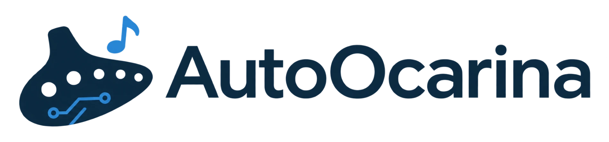
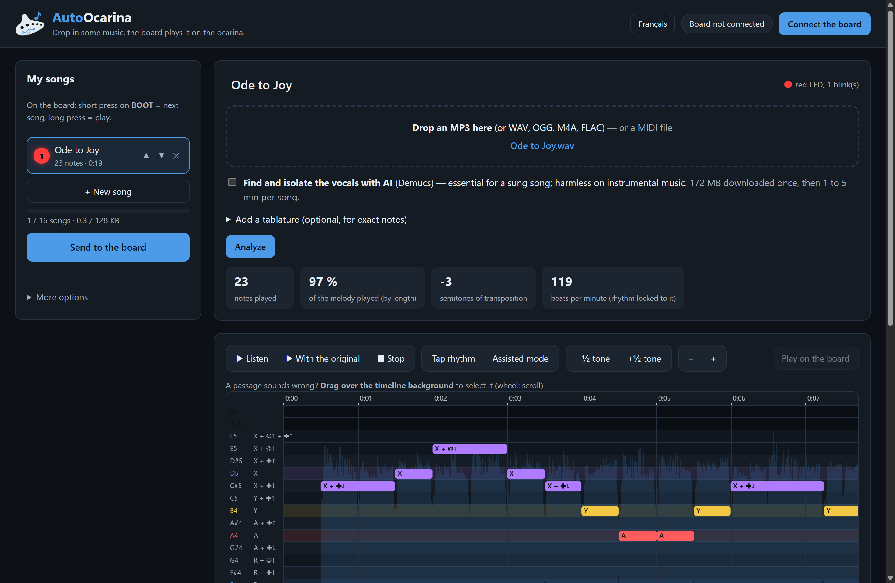
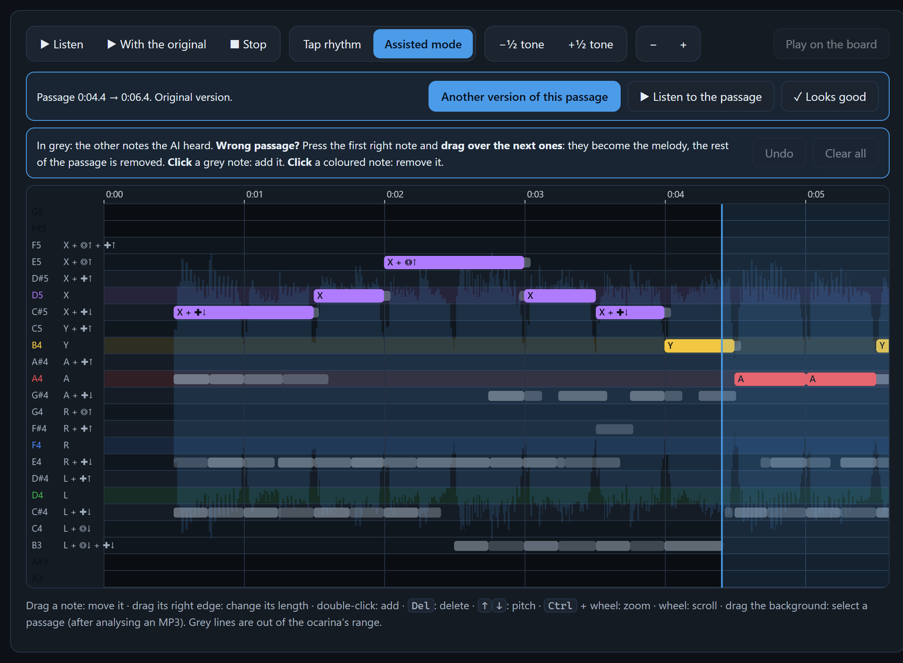
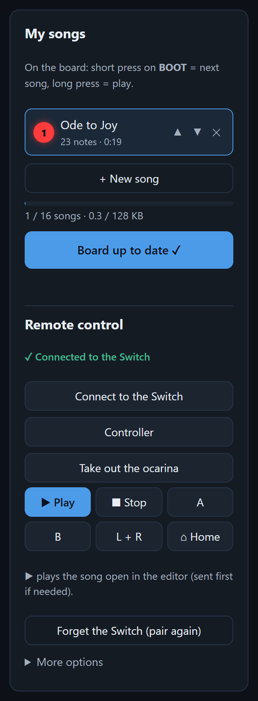
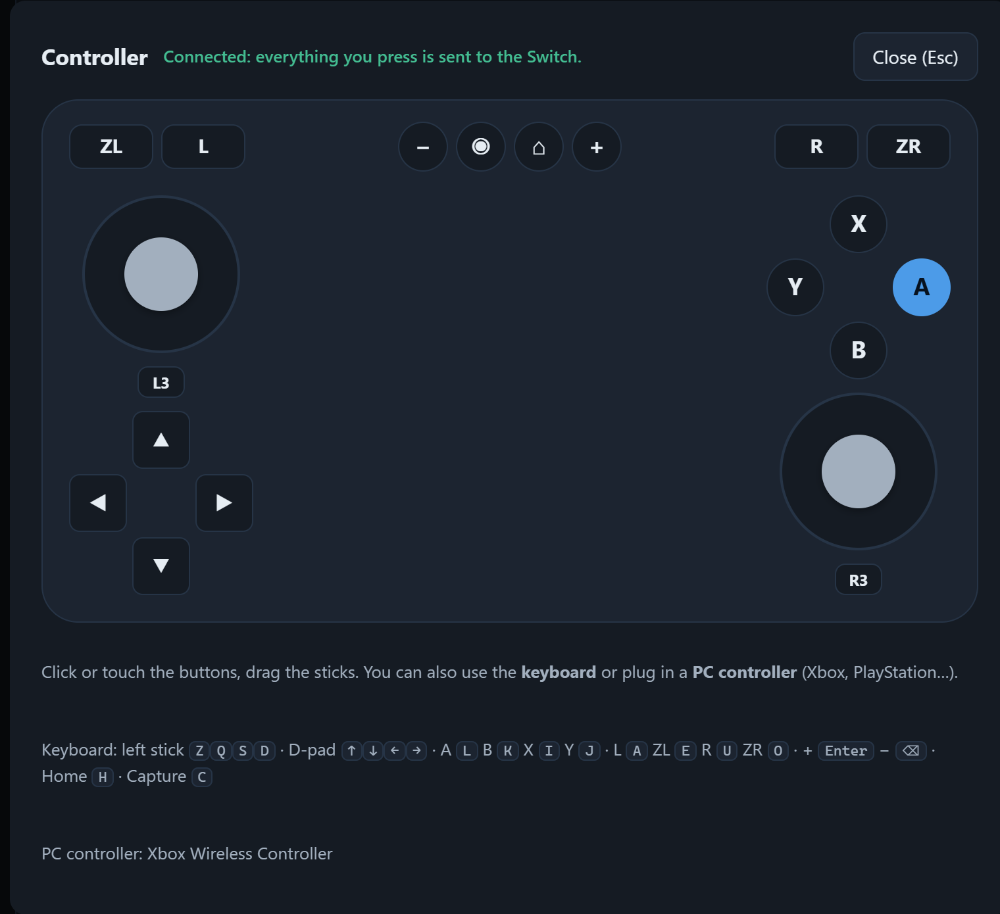

  <picture>
    <source media="(prefers-color-scheme: dark)" srcset="docs/images/banner-dark.png">
    
  </picture>

  
  <a href="README.md">English version</a>

AutoOcarina joue des musiques à l’ocarina dans *The Legend of Zelda: Ocarina of Time* sur Switch 2. Une petite
carte électronique se fait passer pour une manette et appuie sur les boutons à ta place ; une page web qui tourne
sur ton PC transforme un MP3 ou un MIDI en appuis de boutons.

Tout se passe sur ton PC : la page est servie en local et la détection des notes tourne dans le navigateur. Rien
n’est envoyé sur Internet.

## Matériel

Deux types de cartes marchent :

- **Un ESP32 « classique »** (ESP32-WROOM-32 / DevKitC, NodeMCU-32S, D1 mini ESP32, cartes TTGO et Heltec…). Il
  reste branché au PC et joue sur la Switch en Bluetooth : tout se pilote depuis la page. Un écran OLED SSD1306 est
  optionnel. C’est le plus simple.
- **Un Raspberry Pi Pico ou n’importe quelle carte RP2040 / RP2350** (Pico, Pico W, Pico 2, Pico 2 W, Waveshare
  RP2040-Zero / RP2350-Zero, Seeed XIAO RP2040 / RP2350…). On envoie les morceaux depuis le PC, puis on branche la
  carte sur la Switch et on utilise son bouton BOOT.

Pour l’instant, ça a été testé sur une vraie Switch 2 avec un ESP32-WROOM-32 et une Waveshare RP2040-Zero. Les
autres cartes utilisent le même firmware mais n’ont pas encore été essayées sur la console ; les retours sont les
bienvenus.

Les ESP32-S2, S3, C3, C6 et H2 ne marchent pas (pas de Bluetooth classique), pas plus que les Arduino Uno, Nano,
Leonardo ou Pro Micro.

Il faut aussi un câble USB qui transmet les données, et Chrome ou Edge sur un ordinateur : Firefox et Safari ne
savent pas parler aux appareils USB depuis une page web.

## Installation

1. Télécharge le projet (*Code › Download ZIP*) et décompresse-le.
2. Lance la page : double-clique sur `Start AutoOcarina.bat` sous Windows, ou lance `./start.sh` sous macOS / Linux
   (Python 3 requis). Elle s’ouvre dans ton navigateur. Garde la fenêtre de console ouverte pendant l’utilisation.
3. Installe le firmware sur ta carte, une seule fois.

**ESP32**

- Si Windows ne voit pas la carte, installe le pilote de sa puce USB (souvent CH340, parfois CP210x).
- Ouvre [ESP Tool](https://espressif.github.io/esptool-js/) dans Chrome, clique *Connect*, choisis le port de la
  carte, ajoute `app/firmware/autoocarina_esp32.bin` à l’adresse `0x0` puis *Program*. Si ça affiche « Wrong boot
  mode », maintiens BOOT, appuie une fois sur EN, relâche BOOT et recommence.
- Sur la page, clique *Connecter la carte › ESP32 (Bluetooth)*.
- Sur la Switch, va dans *Manettes › Changer la prise/l’ordre*, puis clique *Connecter à la Switch* sur la page. La
  carte apparaît comme une manette Pro et appuie toute seule sur L+R. Ensuite, elle se reconnecte toute seule.

**Pico / RP2040 / RP2350**

- Sur la page, ouvre *Mode d’emploi — carte RP2040 / RP2350*, choisis ta carte et télécharge son firmware.
- Maintiens le bouton BOOT en branchant la carte au PC. Un lecteur `RPI-RP2` (ou `RP2350`) apparaît : copie le
  fichier `.uf2` dessus.
- Clique *Connecter la carte*, choisis *POKKEN CONTROLLER*, puis *Envoyer à la carte*.
- Branche la carte sur la Switch. Appui court sur BOOT : morceau suivant. Appui long : jouer / arrêter. Double appui :
  L+R.

## Ajouter des morceaux

Dépose un fichier sur la page et clique *Analyser*. Un MIDI donne les notes exactes ; pour un fichier audio (MP3,
WAV, OGG, M4A, FLAC), la mélodie est détectée automatiquement, ramenée dans la tessiture de l’ocarina et calée sur
le tempo du morceau. Tu peux aussi coller une tablature d’ocarina.

Écoute avec *Avec l’original* avant d’envoyer à la carte. Quand un passage sonne faux :

- glisse sur le fond de la frise pour le sélectionner, puis clique *Autre version de ce passage* jusqu’à ce que ce
  soit juste ;
- ou ouvre le *Mode assisté* : les notes grises sont tout ce qui a été entendu. Appuie sur la première bonne note
  et glisse sur les suivantes pour en faire la mélodie.

Avec l’ESP32, la télécommande à gauche permet de sortir l’ocarina, de jouer et d’arrêter, et *Manette* ouvre une
manette complète utilisable à la souris, au clavier ou avec une manette de PC, pour naviguer dans les menus de la
Switch sans reprendre les Joy-Con.

  
  &nbsp;
  

## Conseils

- Prends un MIDI quand tu en trouves un. Pour les musiques de jeux, il y en a beaucoup, et la page trouve la piste
  de la mélodie même quand elle passe d’un instrument à l’autre.
- Une reprise jouée par un seul instrument (piano, flûte, ocarina…) marche bien mieux qu’une bande-son complète. La
  détection a du mal quand l’accompagnement est aussi fort que la mélodie.
- Pour une chanson chantée, coche *Repérer et isoler la voix*. Laisse-le décoché pour une musique instrumentale :
  c’est lent, et la première fois il télécharge un modèle de 170 Mo.
- L’ocarina ne va que de Si3 à Fa5. Si la mélodie est plus large, certains passages sont déplacés d’une octave ;
  essaie −½ / +½ ton si ça sonne bizarre.
- Dans les *Réglages*, choisis la disposition des boutons comme dans les options du jeu (Normale ou Classique), et
  utilise le test de rapidité pour trouver la note la plus courte que ta console suit.
- Sur un PC peu puissant : le MIDI et les tablatures sont instantanés, coupe l’audio à la partie qui t’intéresse,
  laisse l’isolation de la voix décochée, ferme les autres onglets et vérifie que l’accélération matérielle est
  activée dans le navigateur. Un MP3 de 3 minutes prend environ 20 secondes à une minute et demie sur un PC moyen.

## Problèmes courants

- **La carte n’apparaît pas :** essaie un autre câble et un autre port USB, installe le pilote CH340/CP210x pour un
  ESP32, et ferme ce qui utilise déjà le port (Arduino IDE, moniteur série, autre onglet).
- **La Switch ne voit pas l’ESP32 :** ouvre d’abord *Changer la prise/l’ordre*, puis clique *Connecter à la Switch*
  et attends une minute. Toujours rien : *Oublier la Switch* et recommence.
- **Notes fausses ou ratées dans le jeu :** vérifie la disposition des boutons, monte la *Durée minimale d’une note*
  et remets *Notes liées* sur le réglage conseillé.
- **Couleurs de la LED inversées :** change `LED_ORDER_RGB` dans `firmware/src/led.h` et recompile.

## Compiler

La page et les firmwares prêts à l’emploi sont déjà dans `app/`. Pour modifier le code, voir
[docs/BUILDING.md](docs/BUILDING.md). Le format des morceaux et les protocoles des cartes sont dans
[docs/FORMAT.md](docs/FORMAT.md).

## Crédits

Détection des notes : [Basic Pitch](https://github.com/spotify/basic-pitch-ts) (Spotify, Apache-2.0). Séparation de
la voix : [Demucs](https://github.com/facebookresearch/demucs) (Meta, MIT) via
[demucs-web](https://github.com/timcsy/demucs-web). Transport Bluetooth de l’ESP32 :
[Friend Maker](https://github.com/zhouxiyu1997/friendmaker), d’après UARTSwitchCon (GPL-3.0). Descripteurs USB HORI :
[GP2040-CE](https://github.com/OpenStickCommunity/GP2040-CE) (MIT). Aussi
[pico-examples](https://github.com/raspberrypi/pico-examples), [@tonejs/midi](https://github.com/Tonejs/Midi),
[ONNX Runtime Web](https://github.com/microsoft/onnxruntime) et [U8g2](https://github.com/olikraus/u8g2). Tableau des
notes de l’ocarina : [LoZ-Ocarina-Note-Charts](https://github.com/diacoviello/LoZ-Ocarina-Note-Charts).

## Licence

[GPL-3.0](LICENSE).

Projet de fan non officiel, sans lien avec Nintendo. Aucun contenu du jeu n’est fourni.
