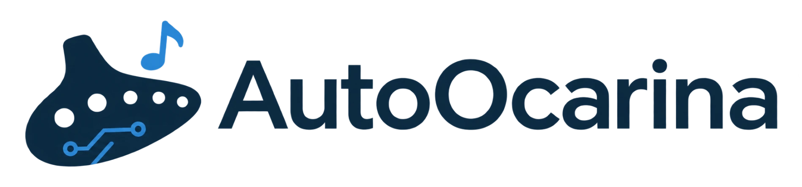
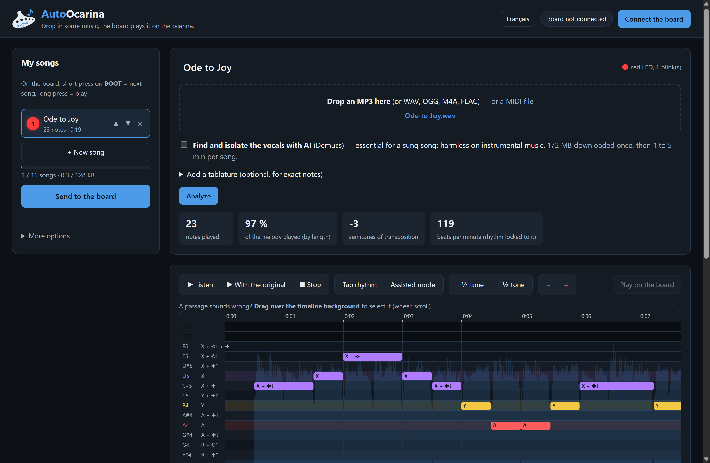
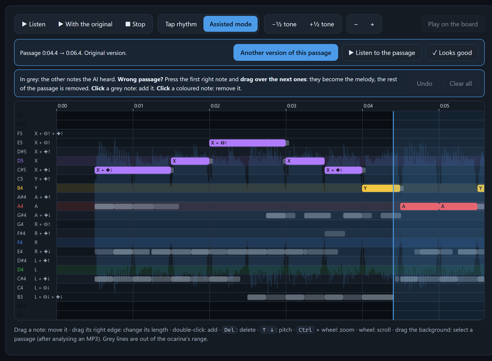
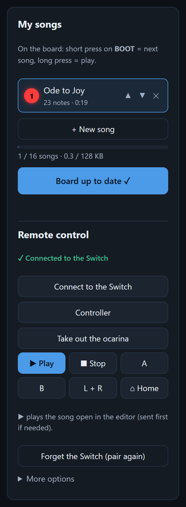
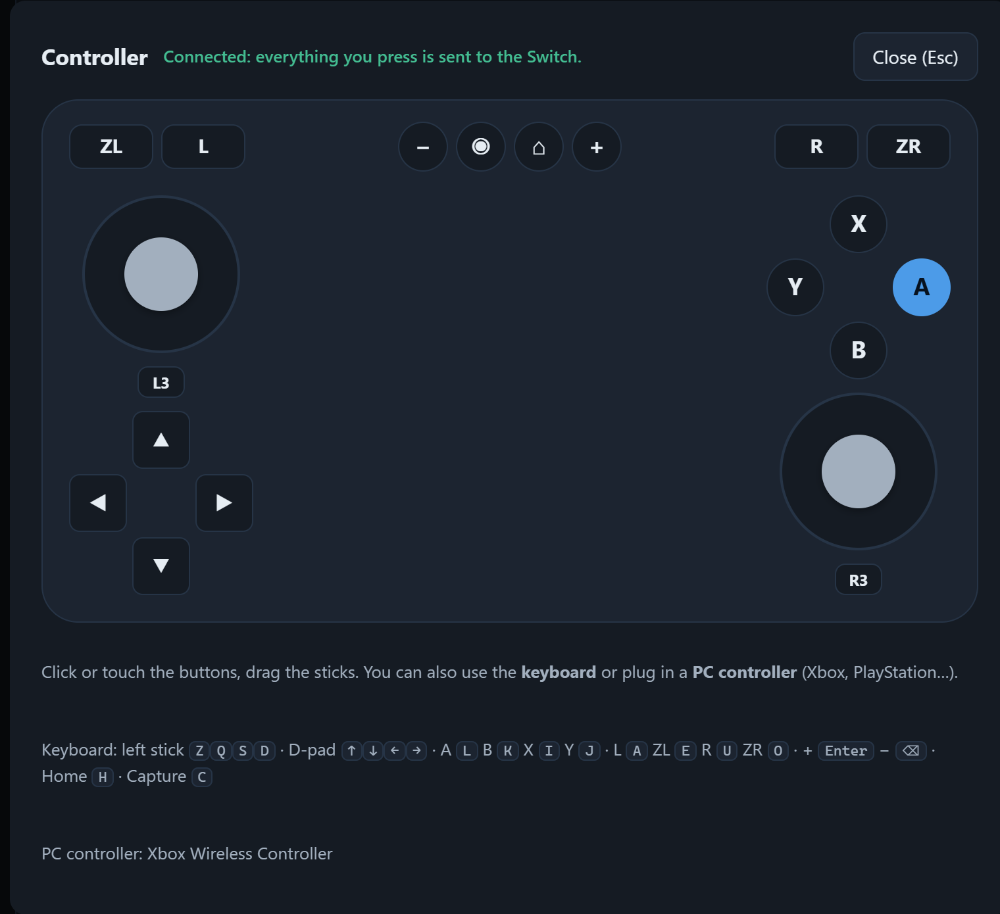

  <picture>
    <source media="(prefers-color-scheme: dark)" srcset="docs/images/banner-dark.png">
    
  </picture>

  
  <a href="README.fr.md">Version française</a>

AutoOcarina plays songs on the ocarina in *The Legend of Zelda: Ocarina of Time* on Switch 2. A small
microcontroller pretends to be a controller and presses the buttons for you; a web page running on your PC turns
an MP3 or MIDI file into those button presses.

Everything runs locally: the page is served from your PC and the note detection runs in the browser. Nothing is
uploaded anywhere.

## Hardware

Two kinds of boards work:

- **A "classic" ESP32** (ESP32-WROOM-32 / DevKitC, NodeMCU-32S, D1 mini ESP32, TTGO and Heltec boards…). It stays
  plugged into the PC and plays on the Switch over Bluetooth, so you control everything from the page. An SSD1306
  OLED screen is optional. This is the easier option.
- **A Raspberry Pi Pico or any RP2040 / RP2350 board** (Pico, Pico W, Pico 2, Pico 2 W, Waveshare RP2040-Zero /
  RP2350-Zero, Seeed XIAO RP2040 / RP2350…). You load the songs from the PC, then plug the board into the Switch and
  use its BOOT button.

So far it has been tested on a real Switch 2 with an ESP32-WROOM-32 and a Waveshare RP2040-Zero. The other boards
run the same firmware but haven't been tried on the console yet; reports are welcome.

ESP32-S2, S3, C3, C6 and H2 won't work (no classic Bluetooth), and neither will Arduino Uno, Nano, Leonardo or Pro
Micro boards.

You also need a USB cable that carries data, and Chrome or Edge on a computer: Firefox and Safari can't talk to USB
devices from a web page.

## Setup

1. Download the project (*Code › Download ZIP*) and unzip it.
2. Start the page: double-click `Start AutoOcarina.bat` on Windows, or run `./start.sh` on macOS / Linux (needs
   Python 3). It opens in your browser. Keep the console window open while you use it.
3. Install the firmware on your board, once.

**ESP32**

- If Windows doesn't detect the board, install the driver for its USB chip (usually CH340, sometimes CP210x).
- Open [ESP Tool](https://espressif.github.io/esptool-js/) in Chrome, click *Connect*, choose the board's port,
  add `app/firmware/autoocarina_esp32.bin` at address `0x0` and click *Program*. If it says "Wrong boot mode", hold
  BOOT, tap EN, release BOOT and try again.
- On the page, click *Connect the board › ESP32 (Bluetooth)*.
- On the Switch, go to *Controllers › Change Grip/Order*, then click *Connect to the Switch* on the page. The board
  shows up as a Pro Controller and presses L+R by itself. It reconnects on its own after that.

**Pico / RP2040 / RP2350**

- On the page, open *How to use — RP2040 / RP2350 board*, pick your board and download its firmware.
- Hold the BOOT button while plugging the board into the PC. A drive called `RPI-RP2` (or `RP2350`) appears: copy
  the `.uf2` file onto it.
- Click *Connect the board*, pick *POKKEN CONTROLLER*, then *Send to the board*.
- Plug the board into the Switch. Short press on BOOT: next song. Long press: play / stop. Double press: L+R.

## Adding songs

Drop a file onto the page and click *Analyze*. MIDI files give exact notes; for audio files (MP3, WAV, OGG, M4A,
FLAC) the melody is detected automatically, fitted into the ocarina's range and synced to the song's tempo. You can
also paste an ocarina tab.

Listen with *With the original* before sending it to the board. When a passage sounds wrong:

- drag over the timeline background to select it, then click *Another version of this passage* until it sounds
  right;
- or open *Assisted mode*: the grey notes are everything that was detected. Press the first correct note and drag
  over the next ones to make them the melody.

With the ESP32, the remote on the left lets you take out the ocarina, play and stop, and *Controller* opens a full
virtual controller you can use with the mouse, the keyboard or a PC gamepad, to get through the Switch menus
without picking up the Joy-Con.

  
  &nbsp;
  

## Tips

- Use a MIDI when you can find one. For game music there are plenty around, and the page picks the melody track
  even when it moves between instruments.
- A cover played on one instrument (piano, flute, ocarina…) works much better than a full soundtrack. The detection
  struggles when the accompaniment is as loud as the melody.
- For songs with vocals, tick *Find and isolate the vocals*. Leave it off for instrumental music: it's slow, and
  the first time it downloads a 170 MB model.
- The ocarina only covers B3 to F5. Wider melodies get some passages moved by an octave; try −½ / +½ tone if it
  sounds odd.
- Set the button layout in *Settings* to match the game options (Normal or Classic), and use the speed test song
  to find the shortest note your console keeps up with.
- On a slower PC: MIDI and tabs are instant, cut the audio to the part you want, keep the vocals option off, close
  other tabs and make sure hardware acceleration is on in the browser. A 3-minute MP3 takes about 20 seconds to a
  minute and a half on a mid-range PC.

## Troubleshooting

- **Board not listed:** try another cable and USB port, install the CH340/CP210x driver for an ESP32, and close
  anything else using the port (Arduino IDE, serial monitor, another tab).
- **Switch doesn't see the ESP32:** open *Change Grip/Order* first, then click *Connect to the Switch* and give it a
  minute. Still nothing: *Forget the Switch* and pair again.
- **Wrong or missed notes in game:** check the button layout, raise *Minimum note length*, and set *Linked notes*
  back to the default.
- **LED colours look swapped:** change `LED_ORDER_RGB` in `firmware/src/led.h` and rebuild.

## Building

The ready-to-use page and firmwares are already in `app/`. To work on the code, see
[docs/BUILDING.md](docs/BUILDING.md). The song format and the board protocols are in
[docs/FORMAT.md](docs/FORMAT.md).

## Credits

Note detection: [Basic Pitch](https://github.com/spotify/basic-pitch-ts) (Spotify, Apache-2.0). Vocal separation:
[Demucs](https://github.com/facebookresearch/demucs) (Meta, MIT) via [demucs-web](https://github.com/timcsy/demucs-web).
ESP32 Bluetooth transport: [Friend Maker](https://github.com/zhouxiyu1997/friendmaker), based on UARTSwitchCon
(GPL-3.0). HORI USB descriptors: [GP2040-CE](https://github.com/OpenStickCommunity/GP2040-CE) (MIT). Also
[pico-examples](https://github.com/raspberrypi/pico-examples), [@tonejs/midi](https://github.com/Tonejs/Midi),
[ONNX Runtime Web](https://github.com/microsoft/onnxruntime) and [U8g2](https://github.com/olikraus/u8g2). Ocarina
note chart from [LoZ-Ocarina-Note-Charts](https://github.com/diacoviello/LoZ-Ocarina-Note-Charts).

## License

[GPL-3.0](LICENSE).

Unofficial fan project, not affiliated with Nintendo. No game content is included.
